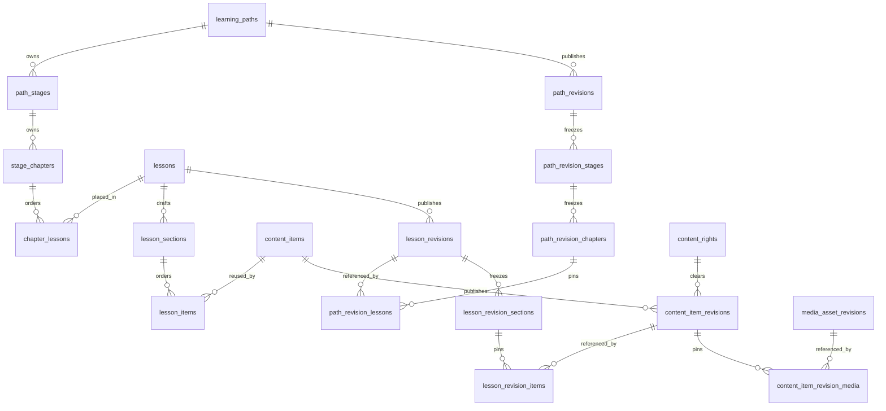

# Technical Architecture & Data Model

## System topology
`Browser → Vercel / Next.js → HTTPS → Render Free / Spring Boot → TLS PostgreSQL → Neon Free`

This is the **target deployment topology**, not a deployed environment verified by this repository. Current source has a Next.js frontend, Spring Boot backend, PostgreSQL/Flyway configuration, session auth, and JPN-020–JPN-023 content work merged in `origin/main`. JPN-022 provides an authenticated local operator CLI, not an HTTP operator API. JPN-023 adds original draft content verified in an isolated database; qualified human review and production publication are pending. Hosting, guest quota and learner progress remain planned.

- Next.js TypeScript frontend. Java Spring Boot modular monolith REST API.
- Neon managed PostgreSQL; Flyway migration history in repository.
- Planned backend domains: `identity`, `content`, `learning`, `practice`, `quota`, `contentimport`, `admin`, `common`. Current source has `auth`, `common`, `content`, and a `contentimport` validation/operator package; the other domains remain planned.
- Prefer standard PostgreSQL, env-based config, and no vendor-specific business logic for portability.

### Frontend loading boundary

The shared `Skeleton` and `SkeletonRegion` in `nichigo_frontend/src/components/ui/` provide decorative shapes and one accessible loading announcement for genuine initial data requests. Feature compositions preserve the proportions of their eventual content. The current Home state adapter uses a Study Desk skeleton only while Redux checks the existing auth session; guest, authenticated-empty and unavailable states use their established content. Railway and Skills compositions are exported for future data adapters but are not mounted on their current static preview/empty routes. Short auth form submissions retain their button pending state. No `loading.tsx` route boundary is added while these routes have no server-side content load; future data integrations should place Suspense boundaries at the data-backed region and keep the AppShell stable. See the [design rules](07-DESIGN-SYSTEM.md#skeleton-loading-system).

## Repository structure (approved — JPN-001)
```
nichigo_frontend/         # Next.js frontend (App Router, TypeScript)
nichigo_backend/          # Spring Boot backend (Maven Wrapper, Java 21)
content/schemas/          # CSV/JSON validation schemas
content/packages/         # Draft content packages; publication requires review
infra/                    # Deployment docs/config (no secrets)
docs/                     # Project documents
contracts/                # Proposed API and import contracts
antigravity/              # Agent operating guide
.github/workflows/        # GitHub Actions CI
```

## Data model (conceptual, adjust with migrations)
The list below is the historical target sketch, not a table-by-table description of current migrations. `origin/main` has V1–V8, including V6 Rights history, V7 Path eligibility and V8 operator pipeline metadata. Guest, quiz and learner-progress tables remain absent. See JPN-002 and JPN-010A implementation notes for the earlier schema.
The [Nichigo Hybrid curriculum proposal](04-CONTENT-AND-LEARNING.md) adds a conceptual Learning Path → Stage → Chapter → Lesson hierarchy, independent Skills/Practice entry points, and separate lesson-completion versus item-mastery concerns. The merged JPN-020 model represents the hierarchy with identified tables; Railway station granularity remains open.

- `users(id,email,password_hash,status,created_at)`; `auth_sessions(id,user_id,expires_at,revoked_at)`.
- `guest_sessions(id,created_at,last_seen_at)`; `guest_claims(guest_id,user_id,claimed_at)`.
- `learning_paths(id,slug,title,visibility)`; `path_lessons(path_id,lesson_id,sort_order)`; `levels(id,code)`.
- `lessons(id,slug,title,status,version,level_id)`; `lesson_items(id,lesson_id,item_type,content_id,sort_order)`.
- `vocabulary`, `grammar_points`, `kana`, `kanji`, `examples`, `media_assets`, `content_provenance`.
- `questions(id,lesson_id,kind,...)`; `answer_options`; `exercise_attempts`; `attempt_answers`.
- `lesson_progress(id,actor_type,actor_id,lesson_id,status,completed_at)`; `item_progress`; `review_schedule` (optional advanced).
- `guest_daily_usage(guest_id,local_date,quota_type,used_count)` with unique composite key.
- `import_batches(id,source,status,created_at)`; `import_records`; `audit_logs`.

Use canonical content references and a join table for lesson membership. Include uniqueness constraints for progress and import keys; enforce quotas atomically with transactions and locks/conditional upsert. Store timestamps in UTC; compute guest quota date in Asia/Ho_Chi_Minh.

## JPN-020 learning content foundation (merged in `origin/main`)

Flyway V4 adds relational editorial identities and sealed public revisions. The conceptual Hybrid hierarchy is represented as `learning_paths → path_stages → stage_chapters → chapter_lessons → lessons`. Stage and Chapter are independently identified and ordered; a Lesson may be placed in more than one Chapter, subject to a later progress-semantics decision. Skills reads published canonical Items independently of path placements. A Course entity, learner progress, assessment attempts and unlock rules are absent.



Path, Lesson, Item and Media draft roots each carry a nullable `published_revision` pointer and an independent editorial status. Published revisions freeze display text, ordering, objectives, typed JSONB payloads and exact child revision keys. Revision roots are assembled while unsealed; PostgreSQL row locks on the parent serialize child inserts with sealing. Sealing requires cleared rights and eligible pinned children. The database permits only the one-time `sealed_at` transition and rejects later inserts, updates and deletes of revision rows. Composite FKs prevent a public pointer from targeting another identity. JPN-022 adds an operator CLI that publishes Media, Item, Lesson and Path with expected edit versions, explicit dependency pins and one transaction per root.

`media_revision_public`, `item_revision_public`, `lesson_revision_public` and `path_revision_public` evaluate exact revision dependencies and current rights clearance. Public JDBC read services use a repeatable-read transaction and a fixed number of ordered queries. A revoked rights record or withdrawn identity makes the entire affected Item, Lesson or Path unavailable; required children are not silently omitted. Already issued public CDN URLs cannot be retracted by this API, so media delivery needs private objects or short-lived authorized URLs before release. API responses expose media metadata without a storage key or permission evidence.

The independent `/api/v1/lessons/{slug}` read resolves the Lesson root's current published revision. The contextual `/api/v1/learning-paths/{pathSlug}/placements/{placementId}/lesson` read first resolves the current eligible Path revision, verifies the placement belongs to it, checks the pinned Lesson and dependencies, then assembles that exact Lesson revision using the same DTO and ordered queries. Neither route accepts a client-selected revision. A Path may therefore remain pinned to Lesson v1 after the independent Lesson root advances to v2; republishing the Path with a v2 pin changes the contextual result. Historical audit requires a separate authorized internal contract and is not exposed here.

Kind-specific Item fields are JSONB with a DB object check; JPN-021 validates their kind-specific shapes before authoring. JPN-022 implements import and publication through an authenticated local operator CLI; withdrawal remains a documented limitation. JPN-023 provides a three-Lesson original draft verified only in an isolated database; qualified human language/Rights review, owner curriculum acceptance and production publication remain pending. JPN-030 and JPN-031 will consume published reads. JPN-032 is planned to record graded attempts with pinned revision keys, while JPN-040 will keep lesson completion and item mastery separate. The approved Learning Experience v1 rules are in [ADR-016–017](02-DECISIONS.md); quiz, unlock, quota and progress behavior is not implemented. Neither JF/CEFR nor JLPT equivalence is inferred by the schema.

## JPN-ARCH-002 rights history and Path eligibility (merged baseline)

V6 adds append-only `content_rights_events`. It captures the current V4/V5 Rights state at upgrade and each later clearance transition, including private provenance evidence. Once a Rights row is cleared, its reviewed source, attribution, permission basis, evidence reference and review timestamp cannot change; clearance may only stay cleared or become revoked. A revoked row cannot be reapproved. Review actor authorization and event attribution belong to JPN-022; the V6 baseline cannot reconstruct changes made before upgrade. The event table is internal and must not be exposed through public APIs.

V7 replaces the Path SQL function's repeated nested Lesson/Item/Media eligibility calls with set-based checks over the exact pinned revision graph. It checks root, Stage, Chapter, Lesson, Item and Media Rights, sealing and withdrawal. Existing foreign keys and `NOT NULL` rights on published Stage/Chapter rows remain. The root pointer and Option B pin behavior do not change. Local synthetic benchmark evidence and draft-model comparison are in [JPN-ARCH-002](implementation/JPN-ARCH-002-content-architecture.md).

## JPN-021 package validation and authoring boundary (merged in `origin/main`)

The offline CLI reads a flat directory of bounded UTF-8 files. `ContentPackageValidator` validates the versioned manifest, parses strict CSV for Rights/Items/Media and JSON arrays for Lessons/Paths, then passes normalized `CanonicalRecord` values to `CanonicalContentValidator`. The latter applies closed-field schemas, kind-specific payload rules, duplicate/order checks, reference and prerequisite-cycle checks, and rights/media checks. A future CMS or JPN-022 operator can call this same normalized-record validator without parsing package files. `ContentSchemaValidator` reads the checked-in schema subset and operates on `JsonNode` values; it is not a general-purpose JSON Schema implementation.

`ContentReferenceResolver` is an optional read-only boundary for resolving existing editorial keys. The JDBC implementation batches parameterized lookups and follows existing Lesson prerequisites by frontier. Without a resolver, unresolved external keys are warnings and `publicationReady` remains false. Package-local keys resolve first, but an Item key already in the database with another kind is a conflict; local Rights declarations always require authorized review even when a matching database key is cleared. V5 adds nullable stable authoring keys to Rights, Lesson Sections and Chapter placements, unique in their respective global, Lesson and Chapter namespaces. Existing UUIDs, order and published pointers are unchanged. JPN-022 uses this parser and resolver for transactional import; V8 adds ownership, batch and operator audit tables. A separate language review and explicit Rights transition gate publication. No dry-run report authorizes publication. See [JPN-022](implementation/JPN-022-content-import-publishing.md).

## Auth and security decisions to implement carefully
JPN-010 implements BCrypt, Spring Security sessions and CSRF for local/source behavior. Production cookie topology, rate limiting and deployment checks below remain open.
- Password hashing Argon2id or bcrypt, never plain text; rate limit login/register.
- Secure, HttpOnly cookies for sessions; cross-site cookie deployment needs explicit `SameSite=None; Secure`, CORS allowlist + credentials and CSRF protection, or use a same-site proxy/custom domain arrangement.
- Never assume Vercel preview URLs are safe CORS origins by wildcard; whitelist approved origins.
- Server-side authorization on every protected endpoint and content import action.
- Secrets in Render/Vercel/Neon environment management, not Git or `NEXT_PUBLIC_*`.
- Consider database connection pooling and server idle connections, short timeouts and bounded retry for transient failures.

## Free tier caveats (must be in deployment runbook)
- Render Free services may spin down after inactivity; first request may be slow and free capacity is limited. Validate current policy before deployment.
- Neon Free has compute/storage/usage limits and compute auto-suspend behavior; check current plan and connection caps.
- Neither free tier is a production availability/backup guarantee. Keep export/restore procedures and test a restore before real beta.
- **Explicit exclusion:** Render Free PostgreSQL is not the long-term database; free DB lifespan and backup limitations are unsuitable for durable progress data.
- No paid upgrade without owner approval.

## Deploy pipeline
1. Git commit → tests/lint/build.
2. Run migrations using controlled release step; fail safely on errors.
3. Deploy API to Render, configure `DATABASE_URL`, session secrets, frontend origin and health check.
4. Deploy Next.js to Vercel, configure API base URL and appropriate server-side env.
5. Smoke test register, login, lesson, quiz, progress, quota, cold start.
6. Export and verify backup process; document incident rollback.

## Observability
Structured error logs (no passwords/tokens), `/actuator/health` with safe public surface, request correlation ID, deployment version, basic metrics. Avoid logging sensitive answer payloads unnecessarily.
