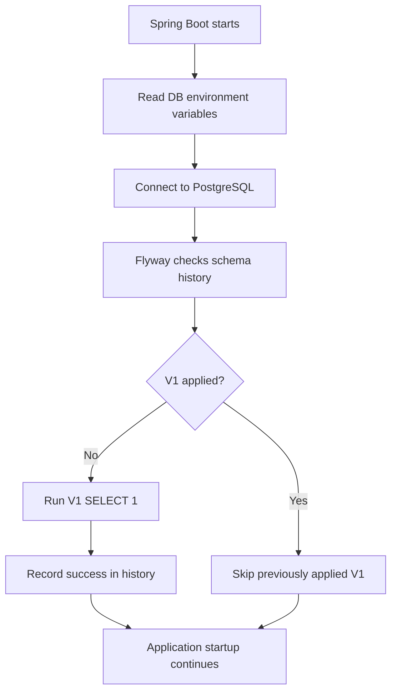

# JPN-002 — PostgreSQL & Flyway Database Baseline

**Trạng thái:** Cấu hình JDBC + Flyway baseline đã có trên `main`.  
**Phạm vi triển khai thực tế:** Kết nối PostgreSQL bằng biến môi trường; Flyway V1 là smoke-test no-op. **Chưa có business schema.**

## 1. Thành phần và vị trí

| File | Vai trò |
| --- | --- |
| `nichigo_backend/pom.xml` | Spring JDBC starter, PostgreSQL JDBC runtime, `spring-boot-starter-flyway`, `flyway-database-postgresql` |
| `nichigo_backend/src/main/resources/application.yml` | DataSource/Flyway + cổng server, CORS config placeholder, actuator exposure |
| `nichigo_backend/src/main/resources/db/migration/V1__baseline.sql` | Migration phiên bản đầu tiên |
| `.github/workflows/ci.yml` | PostgreSQL 17 dành riêng cho backend CI |

Spring Boot 4 cần starter Flyway tương ứng để kích hoạt auto-configuration theo dependency trong `pom.xml`.

## 2. Cấu hình chạy local

`application.yml` dùng:

```yaml
spring:
  datasource:
    url: ${DB_URL}
    username: ${DB_USERNAME}
    password: ${DB_PASSWORD}
  flyway:
    enabled: true
    locations: classpath:db/migration
```

Đặt environment variables (giá trị **ví dụ**, không dùng lại password trong tài liệu):

```text
DB_URL=jdbc:postgresql://localhost:5432/nichigo
DB_USERNAME=<local_db_user>
DB_PASSWORD=<local_db_password>
```

`DB_URL` phải dùng prefix JDBC `jdbc:postgresql://`. Với IntelliJ: Run → Edit Configurations → Environment variables. Một file `.env` đứng cạnh project **không tự động được Spring Boot load**.

PostgreSQL là DB engine; DBeaver chỉ là công cụ quản trị/xem dữ liệu. Neon là hướng triển khai production sau này, **không phải nơi CI kiểm thử**.

## 3. Flyway đang làm gì?

Nội dung V1 thực tế:

```sql
-- JPN-002: Initial database baseline.
-- Business tables will be added in later migrations.
SELECT 1;
```

`SELECT 1` thực thi thành công nhưng **không tạo bảng users/lessons và không ghi dữ liệu nghiệp vụ**. Flyway tự ghi metadata vào bảng `flyway_schema_history`: version, description, script, checksum, thời gian thực thi, success, v.v.

Startup trên một database mới, về nguyên tắc:



Flyway áp dụng script mới theo version và xác minh checksum; **không đồng bộ dữ liệu local sang Neon**.

Đừng sửa nội dung `V1__baseline.sql` đã thực thi. Các bảng nghiệp vụ sẽ thêm bằng `V2__*.sql`, `V3__*.sql`...

## 4. PostgreSQL schema permissions

Quyền trên **database** và trên **schema `public`** không giống nhau. User chạy migrations cần quyền phù hợp để tạo bảng Flyway và bảng nghiệp vụ.

Nếu báo `permission denied for schema public`, một administrator có thể cấp quyền cho role ứng dụng **trong đúng database** (thay role theo môi trường):

```sql
GRANT USAGE, CREATE ON SCHEMA public TO app_role;
```

Không chạy lệnh cấp quyền bừa trên production; xác định chủ sở hữu/schema và chính sách least privilege trước.

## 5. CI

Workflow khởi chạy service `postgres:17`, chờ `pg_isready`, cấp biến `DB_URL`, `DB_USERNAME`, `DB_PASSWORD` **chỉ trong job backend** và chạy Maven test/build.

CI DB là ephemeral: không liên quan database local hoặc Neon. Mật khẩu khai báo trong workflow là **giá trị test cố định**, tuyệt đối không tái sử dụng cho production.

## 6. Verification và hạn chế

- Trong lần thiết lập local, Flyway history đã được kiểm tra qua DBeaver và có record `V1__baseline.sql` success = true.
- Tài liệu này được đối chiếu từ code trên `main`; **không chạy test hoặc truy cập DB trong lượt viết docs**.
- `nichigo_backend/.env.example` hiện vẫn có placeholder `DATABASE_URL` của phiên bản cũ, trong khi runtime đọc **`DB_URL`**, `DB_USERNAME`, `DB_PASSWORD`. Cần đồng bộ file ví dụ ở PR cấu hình phù hợp.
- Không có bảng `users`, khóa ngoại, indexes học tập hay dữ liệu mẫu trong V1. Tránh gọi JPN-002 là “core schema hoàn chỉnh” nếu chưa có migration tương ứng.

## 7. Bước kế tiếp

JPN-010A tạo bảng users trong **Flyway V2** và bổ sung Spring Security. Test auth cần DB riêng; không dùng Neon production.
