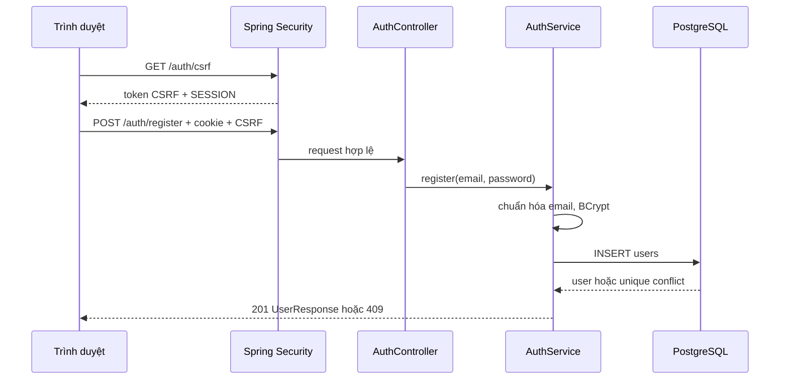
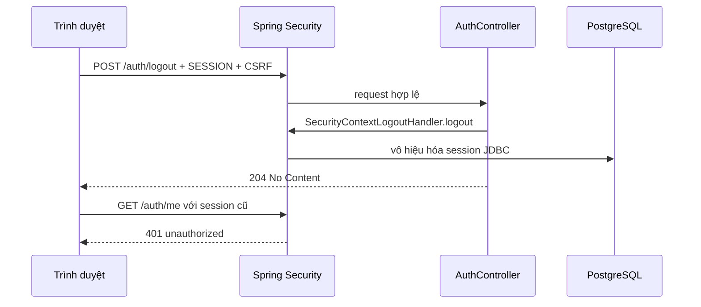

# JPN-010A — Xác thực backend bằng session

## 1. Tổng quan và phạm vi

JPN-010A cung cấp đăng ký, đăng nhập, phiên đăng nhập phía máy chủ, truy vấn người dùng hiện tại, đăng xuất và token CSRF cho API Spring Boot. Backend lưu người dùng và session trong PostgreSQL. Mật khẩu được băm BCrypt; cookie session là HttpOnly. Phạm vi này không bao gồm giao diện frontend, cấu hình miền triển khai, BFF hay JWT.

## 2. Vì sao chọn session thay JWT

Nichigo hiện là nền tảng học tiếng Nhật ưu tiên trình duyệt. Cookie session HttpOnly giúp JavaScript phía trình duyệt không đọc được mã session; máy chủ có thể thu hồi phiên khi đăng xuất hoặc khi session hết hạn. Spring Security quản lý principal và quyền truy cập, Spring Session JDBC lưu session để tồn tại qua lần khởi động lại và chia sẻ giữa các instance backend.

JWT thường phù hợp khi nhiều dịch vụ độc lập cần xác minh token mà không tra cứu session trung tâm. Tuy nhiên việc thu hồi token trước thời điểm hết hạn cần thêm cơ chế; lưu token dài hạn trong trình duyệt cũng làm tăng hậu quả khi token bị đánh cắp. Với MVP browser-first, cookie session và CSRF là lựa chọn đơn giản, phù hợp hơn. Đây là quyết định kiến trúc hiện tại, không phải khẳng định session luôn tốt hơn JWT.

## 3. `spring_auth` và Nichigo

`spring_auth` là dự án tham khảo riêng, không thuộc mã nguồn hoặc phạm vi chỉnh sửa JPN-010A. Nichigo dùng API JSON dưới `/api/v1/auth`, bảng `users` riêng và `SESSION` cookie qua Spring Session JDBC. Spring Security tự cung cấp cơ chế nền tảng như `SecurityContext`, bộ lọc xác thực và bảo vệ CSRF; `spring_auth` không phải một phần trong runtime Nichigo.

### Đối chiếu thực tế với project học `spring_auth`

Trong Phase 1, Codex đã đọc project `spring_auth` tại máy local và báo cáo các luồng sau (những nhận xét này dựa trên **báo cáo review của Codex**, không phải việc truy cập lại source `spring_auth` trong lần cập nhật docs này):

- **Register:** kiểm tra username tồn tại, băm mật khẩu bằng BCrypt và lưu người dùng qua JPA.
- **Login:** dùng `AuthenticationManager` kiểm tra username/password, sau đó phát hành JWT đã ký có thời hạn 10 giờ và trả token cho client.
- **Request mang JWT:** `JwtRequestFilter` đọc `Authorization: Bearer ...`, kiểm tra chữ ký/hạn dùng, tìm người dùng và đặt `Authentication` vào Spring Security context.
- **Vấn đề đã được nhận diện:** chưa có refresh-token flow hoặc cơ chế logout/revocation; cấu hình chưa thể hiện rõ việc gắn JWT filter vào security filter chain và sử dụng stateless sessions. Ngoài ra, signing key hardcoded, register response trả password, thiếu request validation, CSRF bị tắt, kiểm tra user tồn tại có race condition và test chỉ kiểm tra context load.

Những vấn đề trên là lý do **không copy nguyên xi** code JWT sang Nichigo. Nichigo áp dụng khái niệm `AuthenticationManager`, `UserDetailsService`, BCrypt và Spring Security, nhưng sử dụng **HTTP session được lưu qua Spring Session JDBC** để logout có thể vô hiệu hóa session tại máy chủ. Lựa chọn này phù hợp giai đoạn browser-first và đã được chấp thuận sau Phase 1, không đồng nghĩa JWT luôn kém phù hợp. Khi phát triển mobile/public API, cần đánh giá lại token storage, short-lived access tokens, refresh-token rotation và revocation.

## 4. Thành phần chính

- `SecurityConfig`: filter chain, quyền endpoint, CSRF, chính sách session, BCrypt, security context và cookie.
- `CorsConfig`: allowlist origin, methods và credentials từ cấu hình.
- `AuthController`: ánh xạ endpoint và điều phối login/logout; login gọi session strategy, lưu `SecurityContext` tường minh.
- `AuthService`: chuẩn hóa email, băm mật khẩu, tra cứu người dùng và cung cấp `UserDetailsService` cho Spring Security.
- `UserRepository` / `JdbcUserRepository`: truy cập người dùng bằng JDBC và câu lệnh tham số hóa.
- DTO trong `auth/dto`: kiểm tra dữ liệu đầu vào và giới hạn trường trả về.
- `ApiExceptionHandler`: chuyển lỗi đăng ký/xác thực thành JSON.
- Flyway: áp dụng schema có phiên bản khi ứng dụng khởi động.

Spring Security đặt `Authentication` đã xác minh vào `SecurityContext`. Các request sau dùng session cookie để khôi phục context. `AuthenticationManager` kiểm tra thông tin đăng nhập bằng `UserDetailsService` và `PasswordEncoder`; controller không tự so sánh mật khẩu thô.

## 5. Luồng đăng ký

1. Trình duyệt lấy CSRF token từ `GET /api/v1/auth/csrf`.
2. Gửi email và mật khẩu cùng cookie session và header CSRF.
3. Bean Validation kiểm tra email và mật khẩu; dịch vụ chuẩn hóa email về chữ thường và trim.
4. BCrypt băm mật khẩu trước khi ghi DB.
5. Chỉ mục unique trên `LOWER(email)` xử lý cả đăng ký đồng thời; vi phạm được trả `409`.
6. API trả thông tin người dùng an toàn, không trả password/hash và không tự đăng nhập tài khoản.



## 6. Luồng đăng nhập

Client gửi email/mật khẩu cùng CSRF. Email được chuẩn hóa, `AuthenticationManager` xác minh BCrypt. Session strategy đổi session ID hiện có để chống session fixation. Controller tạo context mới, gắn authentication và lưu bằng `HttpSessionSecurityContextRepository`. CSRF token cũ bị xóa; client cần lấy token mới sau đăng nhập. Lỗi thông tin xác thực trả chung một thông báo.

```mermaid
sequenceDiagram
    participant B as Trình duyệt
    participant F as Security Filter Chain
    participant C as AuthController
    participant M as AuthenticationManager
    participant DB as PostgreSQL
    B->>F: POST /auth/login + CSRF + cookie
    F->>C: request hợp lệ
    C->>M: authenticate(email, password)
    M->>DB: tìm user và BCrypt match
    DB-->>M: password hash
    M-->>C: Authentication đã xác minh
    C->>C: đổi session ID; lưu SecurityContext
    C->>C: xóa CSRF token cũ
    C-->>B: 200 UserResponse + SESSION mới
    B->>F: GET /auth/csrf + SESSION mới
    F-->>B: token mới
```

## 7. Request đã xác thực

Trình duyệt gửi cookie session tự động. Spring Session JDBC tra session, Spring Security khôi phục `SecurityContext`, rồi authorization kiểm tra `.authenticated()`. Endpoint `me` trả người dùng hiện tại. Session ID không được gửi trong JSON hay đọc qua JavaScript.

## 8. Logout và hết hạn session

Logout là `POST` có CSRF. `SecurityContextLogoutHandler` dọn security context và vô hiệu hóa session; Spring Session xóa dữ liệu session. Session có timeout 30 phút không hoạt động. Session hết hạn hoặc cookie không hợp lệ được xem như anonymous; endpoint riêng trả `401`. Client nên lấy token CSRF mới trước request thay đổi trạng thái tiếp theo. Cookie hết hạn được kiểm soát bởi container/session cookie.



## 9. Quy trình CSRF

CSRF bật cho mọi phương thức thay đổi trạng thái, không loại trừ auth endpoints. `GET /csrf` làm lộ token session-bound trong JSON; client lưu token và gửi trong header `X-CSRF-TOKEN` cùng cookie `SESSION`. CORS credentials không thay thế CSRF. Sau login token cũ bị xóa và cần bootstrap lại. Logout yêu cầu token hợp lệ, sau đó session bị vô hiệu. Với browser client, bật gửi credentials cho request cross-origin; không lưu session ID trong localStorage.

## 10. Flyway V2/V3

- `V2__create_users.sql`: bảng `users` gồm UUID `id`, email tối đa 320 ký tự, `password_hash`, `created_at`, `updated_at`. Unique index trên `LOWER(email)` bảo vệ tính duy nhất không phân biệt hoa thường.
- `V3__create_session_tables.sql`: `SPRING_SESSION` lưu session ID, thời gian tạo/truy cập, thời hạn, principal; `SPRING_SESSION_ATTRIBUTES` lưu thuộc tính session dạng bytea và khóa ngoại cascade. Có index cho session ID, thời gian hết hạn, principal.
- `spring.session.jdbc.initialize-schema=never`: schema do Flyway quản lý, không do Spring Session tự khởi tạo.

## 11. Endpoint và ví dụ

Tất cả đường dẫn dưới đây có prefix `/api/v1`. `SESSION` là cookie HttpOnly do server phát hành. JSON ví dụ không chứa thông tin xác thực thật.

| Method | Đường dẫn | Quyền | Kết quả |
|---|---|---|---|
| GET | `/auth/csrf` | Public | `200 {"headerName":"X-CSRF-TOKEN","token":"…"}` |
| POST | `/auth/register` | Public + CSRF | `201 UserResponse`; trùng email `409` |
| POST | `/auth/login` | Public + CSRF | `200 UserResponse` và session cookie; sai thông tin `401` |
| GET | `/auth/me` | Authenticated | `200 UserResponse`; thiếu/hết hạn session `401` |
| POST | `/auth/logout` | Authenticated + CSRF | `204`; request kế tiếp không còn phiên |

Đăng ký:

```http
POST /api/v1/auth/register
Content-Type: application/json
Cookie: SESSION=<cookie>
X-CSRF-TOKEN: <token>

{"email":"learner@example.jp","password":"example-password-123"}
```

Login dùng cùng body/header với `/api/v1/auth/login`. Response user:

```json
{"id":"<uuid>","email":"learner@example.jp","createdAt":"<instant>","updatedAt":"<instant>"}
```

CSRF response có headerName và token. Logout body rỗng, trả 204. Lỗi xác thực:

```json
{"code":"invalid_credentials","message":"Invalid email or password."}
```

Lỗi CSRF trả 403; lỗi đăng ký không hợp lệ trả 400 `invalid_request`; email trùng trả 409 `email_already_registered`; lỗi quyền chung trả 403 `forbidden`. Lỗi kiểm tra Bean Validation có nội dung tổng quát.

## 12. Cấu hình môi trường và IntelliJ

| Biến | Ý nghĩa |
|---|---|
| `DB_URL` | JDBC URL PostgreSQL |
| `DB_USERNAME` | Tên user DB |
| `DB_PASSWORD` | Mật khẩu DB |
| `SERVER_PORT` | Cổng HTTP; mặc định 8080 |
| `ALLOWED_ORIGINS` | Danh sách origin CORS phân tách bằng dấu phẩy |
| `SESSION_COOKIE_SECURE` | `true` bắt buộc trên production HTTPS |
| `SESSION_COOKIE_SAME_SITE` | Thường `Lax`; `None` chỉ dùng với `Secure=true` và HTTPS |

`.env.example` là template có giá trị trống. Spring Boot không nạp `.env` mặc định. Trong workspace, cấu hình IntelliJ Application Run Configuration chứa các environment entries trực tiếp; chưa thấy dotenv plugin/dependency hay cơ chế nạp `.env`. Vì vậy điền biến trong Run/Debug Configuration → Environment variables (hoặc export trong shell) thay vì giả định file `.env` tự được đọc. File `.env` riêng phải tiếp tục được Git ignore. Không đưa giá trị môi trường riêng vào tài liệu/commit.

## 13. Chạy local và thử API

1. Cần Java 21 và PostgreSQL local/test riêng, không trỏ đến database production.
2. Cấu hình đủ bảy biến môi trường ở IntelliJ hoặc shell; local HTTP có thể dùng Secure=false, SameSite=Lax.
3. Chạy `./mvnw spring-boot:run` trên Unix/macOS hoặc `./mvnw.cmd spring-boot:run` trên Windows. Flyway áp dụng migration khi startup.
4. Lấy CSRF bằng `curl -c cookies.txt http://localhost:8080/api/v1/auth/csrf`, trích token từ JSON, gửi cookie và header trong các POST.
5. Gọi register, login, `/auth/me`, rồi logout. Dùng cookie jar để duy trì cookie. Trình duyệt cross-origin cần gửi credentials và origin phải nằm trong allowlist.

## 14. Kiểm thử và kết quả thực tế

`AuthControllerIntegrationTest` bao gồm registration/password hashing, response không lộ hash, kiểm tra email trùng không phân biệt hoa thường, validation, login và `/me`, logout, credentials sai, CSRF bootstrap và lifecycle, session ID rotation, invalid/expired session, health endpoint, và sự tồn tại của bảng Flyway. Một số request dùng CSRF token/session cookie thực được lấy từ `GET /auth/csrf` thay vì chỉ dùng mock CSRF.

**Kết quả do Codex báo cáo sau khi sửa Maven Wrapper và test fixture:**

- `./mvnw.cmd test` — **thành công**.
- `./mvnw.cmd verify` — **thành công**, tạo Spring Boot artifact.
- Tổng cộng **13 tests, 0 failures, 0 errors**.
- Flyway kiểm tra cả ba migration V1/V2/V3; trong lần chạy đầu áp dụng V2/V3 với PostgreSQL local/test, sau đó schema được xác nhận cập nhật.
- Chạy bằng **JDK 25**, với compiler `--release 21`. Chưa xác nhận runtime Java 21; cần GitHub Actions CI (Temurin 21) kiểm tra trước merge.
- Maven Wrapper 3.3.4 `only-script` trên Windows PowerShell 5.1 đã được sửa guard `.Target` null/empty trong `nichigo_backend/mvnw.cmd`. Test hết hạn session cũng được chỉnh theo `EXPIRY_TIME` và session ID giải mã từ cookie.
- Trong môi trường agent, Maven cần quyền ghi user cache và sử dụng database PostgreSQL localhost đã cấu hình trong IntelliJ; **không chạy trên production database**.

Đây là **kết quả test Codex báo cáo**, chưa phải kết quả CI được xác minh độc lập trong lượt cập nhật tài liệu. Trước khi merge cần kiểm tra GitHub Actions chạy thành công trên Java 21.

## 15. Giới hạn bảo mật đã biết

- Chưa có rate limiting, khóa tạm hay MFA chống dò mật khẩu.
- Response email trùng tiết lộ trạng thái tài khoản qua `409`.
- Không có luồng quên/đổi mật khẩu hoặc thu hồi tất cả phiên.
- Không có profile production bắt buộc `SESSION_COOKIE_SECURE=true`; biến này phải được đặt rõ ở môi trường production.
- SameSite=None cần Secure và HTTPS; chạy HTTP local với Secure=true làm cookie không được gửi.
- Cần kiểm thử hành vi proxy khi triển khai, đặc biệt HTTPS termination và forwarded headers.
- Spring Session JDBC chia sẻ session qua DB, nhưng phụ thuộc availability và quyền truy cập PostgreSQL.

## 16. Triển khai tương lai: Vercel, Render và SameSite

Vercel frontend và Render backend dùng domain mặc định khác nhau, tạo bối cảnh cross-site. Cookie bên thứ ba có thể bị trình duyệt hạn chế dù CORS credentials được bật. Ưu tiên dùng `app.<miền-riêng>` và `api.<miền-riêng>` qua HTTPS để hai host cùng site; khi đó SameSite=Lax có thể phù hợp. Nếu thực sự cần cookie cross-site, cần SameSite=None; Secure=true, HTTPS và kiểm thử trên các trình duyệt mục tiêu.

Đặt `ALLOWED_ORIGINS` chính xác, bật HTTPS/secure cookie và cấu hình proxy tin cậy/forwarded headers đúng với hạ tầng trước khi dùng. Next.js BFF có thể được đánh giá trong ticket triển khai nếu cần gom browser traffic về cùng origin. JPN-010A không cấu hình domain, Render, Vercel hay BFF; ràng buộc này cần chuyển cho JPN-050 Deployment.
