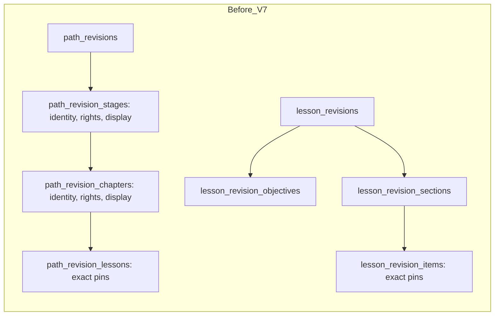
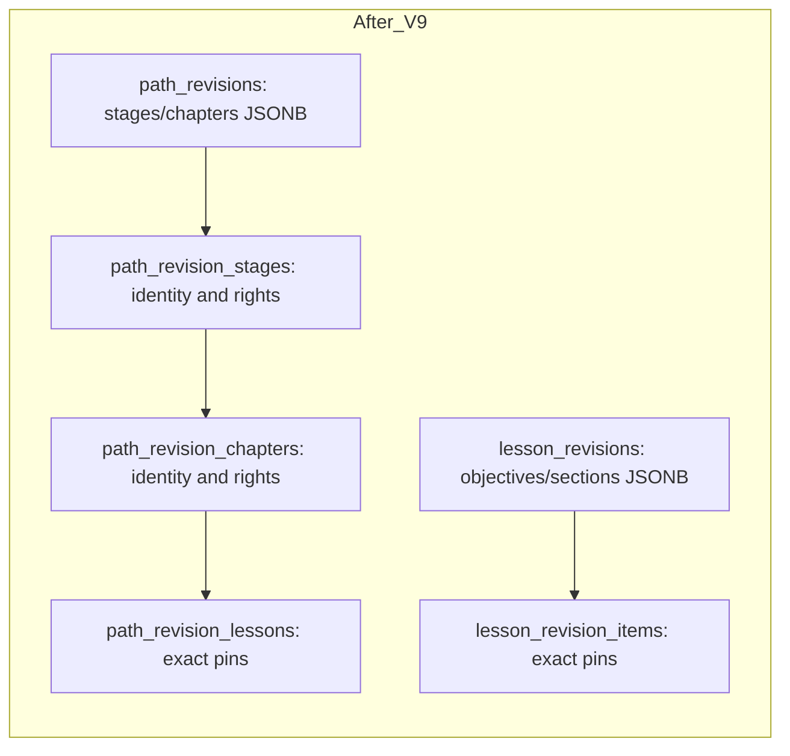

# JPN-ARCH-003 — Hybrid published content

**Status:** PR #26 targets `main` after PR #25 merged. This is an owner-review implementation, not an approved architecture or release. No production publisher or content upload was added.

## Schema and authority

V8 adds `presentation jsonb` to `lesson_revisions` and `path_revisions`, backfills every existing revision under the migration lock, and compares each generated document with the old rows before retaining the new columns. V9 validates the backfill again, then retires `lesson_revision_objectives` and `lesson_revision_sections`. It removes presentation columns from `path_revision_stages` and `path_revision_chapters`, but **retains these tables** for stable Stage/Chapter identity and independent Rights. No tables are added. All other V4–V7 tables are retained, including the V6 Rights events.

The JSONB contains only presentation data and stable layout keys. A Path Chapter JSON key equals the UUID of its thin relational Chapter row; a Lesson Section JSON key equals the `section_id` of relational Item pins. No JSONB copy of Path→Lesson or Lesson→Item revision pins exists. Relational pin positions and FKs remain authoritative. The V9 sealing trigger checks unique keys/order, complete Chapter coverage, exact pin-to-layout reconciliation, prerequisite availability/cycles and size limits. The public service validates the closed versioned schemas again and refuses orphan pins. PostgreSQL keeps PKs, FKs, uniqueness, sealed-revision immutability, pointer checks, Rights and V7 set-based eligibility. The Java `CanonicalContentValidator` shares the schema validation boundary with package validation. A small internal publication boundary validates expected edit version, stored document, live dependencies and locks Rights; JPN-022 must still provide the complete authenticated atomic writer.

Path→Lesson→Item→Media exact revision pins remain relational. Publishing a new Item does not mutate its pinned Lesson, and publishing a new Lesson does not mutate its pinned Path (Option B). Reverse lookup indexes on pins remain. Public reads use sealed revisions and current Rights status; withdrawals and revocations can hide historical revisions without changing their identity. Stage/Chapter Rights stayed relational specifically to preserve this property without a synchronized dependency index.

## Migration and verification

The populated migration test starts with V4 data, advances through V9 and compares stable identities, publication pointers, order, historical presentation, Media pins and Rights events. A separate test proves a V9 validation failure leaves V8 and its old presentation tables intact. Integration tests cover API compatibility, draft isolation, Option B, all six Rights layers, revocation/withdrawal, invalid layouts, a pinned-Item Rights race, public fail-closed behavior under privileged test-only corruption, and transaction rollback. The schema validator has focused invalid-key/type/version tests. On 2026-11-08, `nichigo_backend/.\mvnw.cmd verify --no-transfer-progress -q` using an isolated local PostgreSQL 17 schema `jpn021_arch003_review4_20261108` passed **60 tests, 0 failures, 0 errors, 0 skipped** and Maven verify. The upgrade tests created and removed only their nested schemas. Fresh schemas are required because one existing integration test uses a fixed Rights key. Frontend `npm run lint`, `npm run type-check` and `npm run build` each passed; no frontend source changed.

### V7 versus V9 synthetic performance

The committed JPN-020 fixture has 5 Paths, 5,000 Lessons and 50,000 Items. PostgreSQL 17.4 was initialized in an isolated temporary cluster on the workspace drive after the default local database drive ran out of space. One schema received V1–V4, the fixture and V5–V7; a second received the same sequence then V8–V9. Both had targeted `ANALYZE` on only their own tables. Each query had 20 warm `EXPLAIN (ANALYZE, BUFFERS, FORMAT JSON)` executions; p50/p95 are sorted observations 10 and 19. Timings are representative SQL, not HTTP latency or concurrent throughput.

| Query / 20 warm runs | V7 p50/p95 ms | V9 p50/p95 ms | Median shared hits V7/V9 | Rows |
| --- | ---: | ---: | ---: | ---: |
| Path eligibility, `path_revision_public` | 63.565 / 69.173 | 63.502 / 69.292 | 4,816 / 4,947 | 1 |
| Path detail hierarchy and pinned Lessons | 2.408 / 2.536 | 6.434 / 6.802 | 167 / 349 | 1,000 |
| Lesson detail Section and pinned Items | 0.240 / 0.282 | 0.355 / 0.461 | 53 / 50 | 10 |
| Skills first 20 kana | 4.499 / 4.922 | 4.554 / 5.430 | 397 / 394 | 20 |

The Path eligibility p50 and p95 are effectively unchanged; the V7 set-based optimization is preserved. The original V9 representative Path detail join is about 4 ms slower at p50 because it expands nested JSON, casts Chapter keys and sorts. The follow-up public reader parses each validated document once in Java, eliminating the repeated JSON-expansion SQL queries. The table above remains a diagnostic SQL comparison of the original join shape, **not** the optimized API's query sequence. Skills is effectively unchanged. Publication write throughput is unmeasured because JPN-022's production writer does not exist.

Schema table count fell from 31 to 29 in this fixture (including non-content tables), while summed table-plus-index storage rose from 80,789,504 to 81,248,256 bytes, about 0.57%. This is a structural simplification, not a storage saving. The isolated cluster was stopped after measurements; its temporary data directory at `H:\Code\Projects\jpnarch003_pgbench_20261108` remains because automatic approval review rejected recursive deletion.

### End-to-end HTTP comparison after the read optimization

Both local Spring Boot processes used the same Java 25 runtime, PostgreSQL 17.4 cluster and committed synthetic fixture in separate V7/V9 schemas. The V7 process overrode only the two public repository/service classes with their exact PR #25 versions and disabled Flyway at startup; the V9 process used this branch's built JAR and likewise disabled startup migration. Both schemas were already migrated explicitly. The 1/20/100-Lesson Paths were added with equivalent test-only data; the existing 1,000-Lesson Path is the stress case. A local `HttpClient` made 40 warm requests per route and process, consuming the full body before stopping a wall-clock timer. The Path-size run alternated V7/V9 requests to reduce drift. No network or production cache is involved. One database query count is inferred from the public repository methods; no SQL tracing was enabled. All compared responses returned HTTP 200 and equal byte lengths.

| HTTP request | V7 p50/p95 ms | V9 p50/p95 ms | V7/V9 queries | Body bytes |
| --- | ---: | ---: | ---: | ---: |
| `GET /learning-paths?limit=20` | 186.934 / 250.085 | 208.355 / 277.132 | 1 / 1 | 584 |
| `GET /learning-paths/bench-path-1` (1,000 Lessons) | 61.982 / 85.708 | 60.748 / 86.958 | 4 / 3 | 204,050 |
| `GET /lessons/bench-lesson-1` (10 Items) | 14.553 / 20.711 | 13.461 / 17.201 | 5 / 3 | 2,712 |
| `GET /learning-paths/bench-path-1/placements/{id}/lesson` | 46.769 / 76.906 | 43.081 / 47.535 | 5 / 3 | 2,712 |
| `GET /skills/kana/items?limit=20` | 6.813 / 8.382 | 7.464 / 9.005 | 1 / 1 | 2,884 |
| Path detail, 1 Lesson (alternating) | 44.723 / 73.119 | 45.514 / 63.351 | 4 / 3 | 537 |
| Path detail, 20 Lessons (alternating) | 47.240 / 58.682 | 46.662 / 60.432 | 4 / 3 | 4,125 |
| Path detail, 100 Lessons (alternating) | 46.336 / 54.734 | 47.268 / 60.409 | 4 / 3 | 19,330 |
| Path detail, 1,000 Lessons (alternating) | 50.073 / 89.422 | 49.511 / 79.362 | 4 / 3 | 204,050 |
| Lesson detail, 1 Item (alternating) | 16.071 / 23.924 | 15.364 / 20.092 | 5 / 3 | 488 |
| Lesson detail, 10 Items (alternating) | 14.570 / 20.663 | 13.984 / 19.313 | 5 / 3 | 2,712 |
| Lesson detail, 100 Items (alternating) | 18.504 / 22.291 | 16.983 / 20.908 | 5 / 3 | 25,136 |

The list route is dominated by five Path eligibility evaluations; its serial-run difference is not explained by the presentation read change, which does not touch that route. The alternating Path and Lesson detail runs show comparable p50 across sizes, with noisy p95. Process snapshots after the first series: V7 about 25.86 CPU seconds / 175.3 MiB working set; V9 about 27.19 CPU seconds / 170.7 MiB working set. These are whole-process observations, not per-request attribution. The separate SQL table above supplies buffer activity; no per-HTTP-query buffer trace was captured.

### Publication walkthrough and complexity

The test-only [`jpnarch003-publication-walkthrough.sql`](../../nichigo_backend/src/test/resources/jpnarch003-publication-walkthrough.sql) ran successfully in both isolated V7 and V9 schemas and rolls back every write. It created a two-Section draft, reused an Item, reordered and edited Section metadata, published Lesson v1 and Path v1, published Item v2 and Lesson v2, proved Path v1 still pinned Lesson v1, explicitly published Path v2, caught and rolled back an invalid revision 3, and revoked Rights to make current publications ineligible. The V7 invalid candidate failed a Section FK; the V9 candidate failed closed-field JSON validation at seal. Neither is a production writer.

| Concern | V7 relational | V9 hybrid |
| --- | --- | --- |
| Schema in measured fixture | 31 tables, 219 columns, 155 constraints, 12 functions, 21 user triggers | 29 tables, 205 columns, 145 constraints, 16 functions, 21 user triggers |
| Lesson revision writer | Root, Section rows, Item pins, seal, pointer: 5 statement groups | Root with constructed document, Item pins, seal, pointer: 4 groups plus document/key validation |
| Path revision writer | Root, Stage rows, Chapter rows, Lesson pins, seal, pointer: 6 groups | Same 6 groups; root also needs a constructed document and cross-check of Stage/Chapter keys |
| Referential guarantee | Section FK, Stage/Chapter FKs, all exact pin FKs | Section pin checks at seal; Stage/Chapter and exact pin FKs retained; public reader cross-checks layout keys |
| New application surface | Existing DTO assembly from ordered rows | Two closed document schemas, Java validator and publication-boundary class; DTO assembly parses documents |

V8/V9 add 381 lines of migration SQL for backfill, validation and retirement. Adding a presentation field can avoid a new relational column, but still requires coordinating the closed JSON schema, SQL seal validation when applicable, Java DTO assembly and historical version handling. The Path writer did not become shorter. The production transaction, concurrency and operator requirements remain JPN-022 work. The additional SQL functions and validation surfaces offset the two removed presentation tables in the current scope.

**Owner-review recommendation: REVERT TO RELATIONAL MODEL by declining PR #26.** Integrity and HTTP performance are acceptable after optimization, but the measured implementation does not demonstrate a meaningful reduction in total maintenance or publication complexity. Keep the PR branch as evidence; this recommendation does not authorize a destructive revert or merge. Reconsider JSONB presentation if a real JPN-022 editor shows enough schema churn or authoring cost to justify its validation boundary.

## Boundaries and remaining work

Database roles with DDL or trigger-disabling privileges can bypass the publication guard; production roles must not have those privileges. JPN-022 owns authenticated review/operator attribution, package idempotency, full transactional publication, concurrent dependency rechecks and media delivery authorization. No production writer currently calls the internal boundary. Learner attempts/progress and curriculum decisions remain separate. Full concurrency and media-heavy benchmark coverage remain open.
