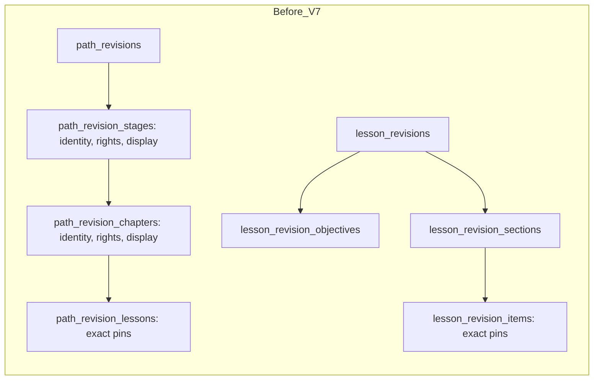
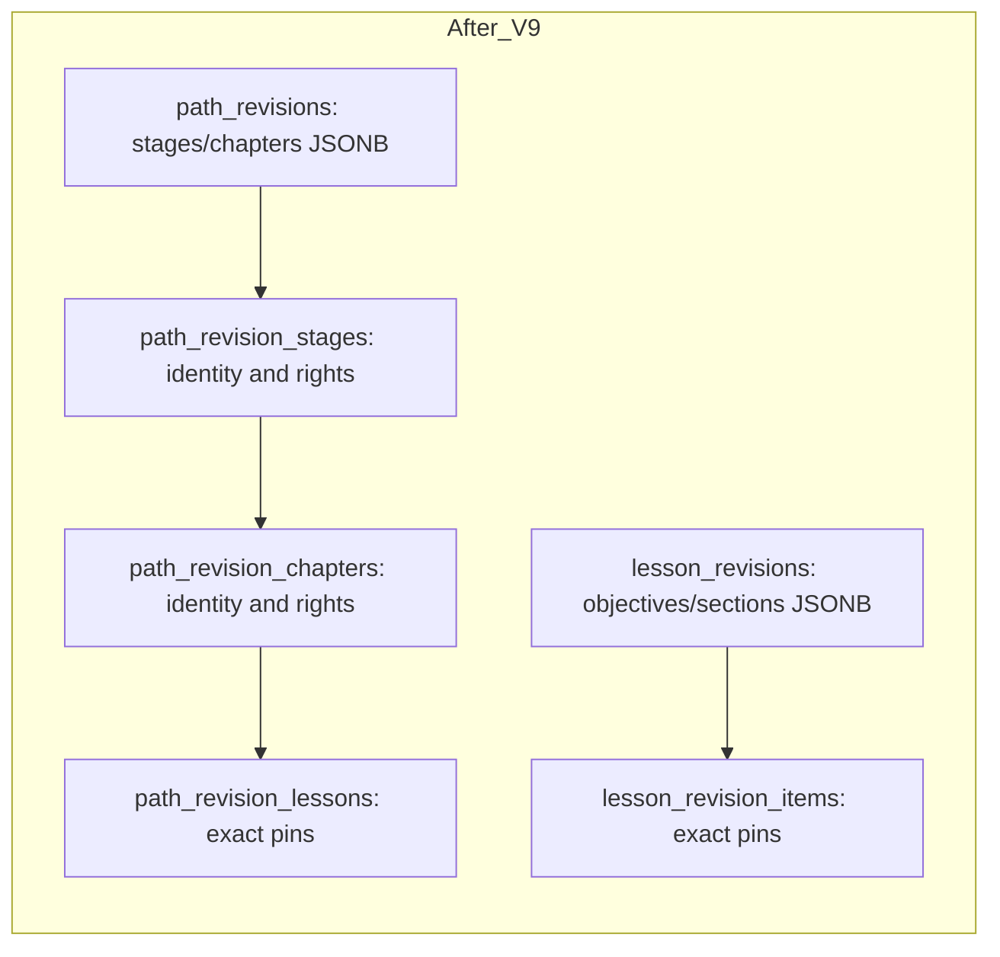

# JPN-ARCH-003 — Hybrid published content

**Status:** Implemented on a stacked review branch. ADR-015 and release require owner review. No production publisher or content upload was added.

## Schema and authority

V8 adds `presentation jsonb` to `lesson_revisions` and `path_revisions`, backfills every existing revision under the migration lock, and compares each generated document with the old rows before retaining the new columns. V9 validates the backfill again, then retires `lesson_revision_objectives` and `lesson_revision_sections`. It removes presentation columns from `path_revision_stages` and `path_revision_chapters`, but **retains these tables** for stable Stage/Chapter identity and independent Rights. No tables are added. All other V4–V7 tables are retained, including the V6 Rights events.

The JSONB contains only presentation data and stable layout keys. A Path Chapter JSON key equals the UUID of its thin relational Chapter row; a Lesson Section JSON key equals the `section_id` of relational Item pins. No JSONB copy of Path→Lesson or Lesson→Item revision pins exists. Relational pin positions and FKs remain authoritative. The V9 sealing trigger checks unique keys/order, complete Chapter coverage, exact pin-to-layout reconciliation, prerequisite availability/cycles and size limits. The public service validates the closed versioned schemas again and refuses orphan pins. PostgreSQL keeps PKs, FKs, uniqueness, sealed-revision immutability, pointer checks, Rights and V7 set-based eligibility. The Java `CanonicalContentValidator` shares the schema validation boundary with package validation. A small internal publication boundary validates expected edit version, stored document, live dependencies and locks Rights; JPN-022 must still provide the complete authenticated atomic writer.

Path→Lesson→Item→Media exact revision pins remain relational. Publishing a new Item does not mutate its pinned Lesson, and publishing a new Lesson does not mutate its pinned Path (Option B). Reverse lookup indexes on pins remain. Public reads use sealed revisions and current Rights status; withdrawals and revocations can hide historical revisions without changing their identity. Stage/Chapter Rights stayed relational specifically to preserve this property without a synchronized dependency index.

## Migration and verification

The populated migration test starts with V4 data, advances through V9 and compares stable identities, publication pointers, order, historical presentation and Rights. Integration tests cover public API compatibility, draft isolation, Option B, revocation/withdrawal, malformed layout rejection at seal and transaction rollback. The new schema validator has focused unit tests. On 2026-11-08, `nichigo_backend/.\mvnw.cmd verify --no-transfer-progress -q` using local PostgreSQL 17 and `DB_URL=jdbc:postgresql://localhost:5432/nichigo?currentSchema=jpn021_arch003_verify2_20261108` passed **56 tests, 0 failures, 0 errors, 0 skipped** and Maven verify. The populated upgrade test created and removed only its own nested schema. A repeat run against a previously used schema failed on an existing test's fixed Rights key; fresh schemas are required for reproducible runs. Frontend `npm run lint`, `npm run type-check` and `npm run build` each passed; no frontend source changed.

The committed JPN-020 synthetic fixture has 5 Paths, 5,000 Lessons and 50,000 Items. A V7→V9 side-by-side rerun was attempted in a new disposable schema. Fixture loading failed with PostgreSQL `No space left on device`; the incomplete schema was removed. Thus V7-vs-V9 p50/p95, plans, buffers, detail/Skills and storage comparisons are **unverified**. JPN-ARCH-002's V7 eligibility baseline was 31.351/32.562 ms p50/p95 with 3,840 median buffer hits, but it is not a V9 comparison. Do not claim a performance gain from this change. Rerun the identical fixture before merge on a machine with adequate PostgreSQL disk space.

## Boundaries and remaining work

Database roles with DDL or trigger-disabling privileges can bypass the publication guard; production roles must not have those privileges. JPN-022 owns authenticated review/operator attribution, package idempotency, full transactional publication, concurrent dependency rechecks and media delivery authorization. No production writer currently calls the internal boundary. Learner attempts/progress and curriculum decisions remain separate. Full concurrency and media-heavy benchmark coverage remain open.
